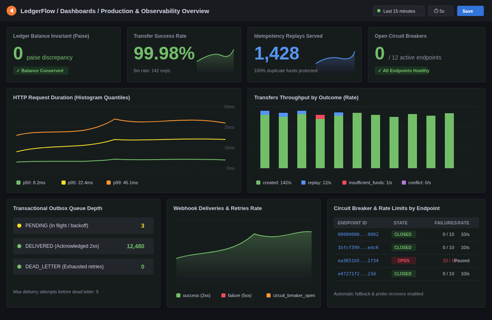

# LedgerFlow 🌊

[](https://www.typescriptlang.org/)
[](https://nodejs.org/)
[](https://www.postgresql.org/)
[](https://redis.io/)
[](https://prometheus.io/)
[](https://grafana.com/)
[](https://www.docker.com/)
[](https://github.com/features/actions)
[](https://vitest.dev/)
[](https://opensource.org/licenses/MIT)

> **LedgerFlow** is an enterprise-grade, multi-tenant, idempotent double-entry financial ledger and webhook delivery engine that guarantees strict balance conservation (0 paise lost or created), zero-overdraft concurrency control, cryptographic API-key multi-tenancy, and at-least-once signed webhook dispatch with automatic crash recovery.

---

## Architecture

LedgerFlow decouples synchronous money movement from asynchronous partner notification using the **Transactional Outbox Pattern** and a multi-tier **Idempotency Guard**.

```mermaid
flowchart LR
    Client["Client / Chaos UI<br/>(Bearer API Key Auth)"]
    API["Express API Server<br/>(Zod Validation + Scoped Idempotency)"]
    Redis[("Redis 7<br/>• Namespaced Mutex (NX)<br/>• Fast Replay Cache<br/>• BullMQ Work Queue<br/>• Circuit Breaker (CLOSED/OPEN/HALF_OPEN)<br/>• Token Bucket Rate Limiter (Lua)")]
    Postgres[("PostgreSQL 16<br/>• merchants & api_keys<br/>• accounts (tenant-scoped)<br/>• ledger_entries (Immutable)<br/>• webhook_endpoints & cb_state<br/>• outbox_events & delivery_attempts")]
    Worker["Outbox Worker<br/>(BullMQ Consumer + Concurrency Guard + Fair Poller)"]
    SSRF["SSRF Defense Engine<br/>• DNS Rebinding Pinning<br/>• Private & Metadata Filter<br/>• Hop-by-Hop Redirect Check"]
    Merchant["Registered Webhook Receivers<br/>(Stripe-Style HMAC t=...,v1=...<br/>Dedupe: X-LedgerFlow-Event-Id)"]

    Client -->|1. POST /transfers (Idempotency-Key)| API
    API -->|2. SET idemp:merchant:key LOCKED NX| Redis
    API -->|3. ACID Tx: Lock Accounts, Entries, Fan-out Outbox| Postgres
    API -->|4. Release lock & Cache response| Redis
    Worker -->|5. Sweep PENDING events (fair partition)| Postgres
    Worker -->|6. Process job: Check Circuit Breaker & Rate Limit| Redis
    Worker -->|7. Validate & pin target IP (hard timeout)| SSRF
    SSRF -->|8. POST payload + HMAC signature (event_id, delivery_id)| Merchant
    Worker -->|9. Record delivery_attempt & update breaker state| Postgres
```

---

## One-Command Setup

Run the entire production stack (API server, Background Worker, PostgreSQL 16, Redis 7, and interactive Chaos Simulator UI) with a single command:

```bash
docker compose up -d --build
```

Verify service health:
```bash
curl http://localhost:3000/health
```

```json
{
  "status": "ok",
  "timestamp": "2026-11-17T11:14:53.447Z",
  "services": {
    "postgres": { "status": "up", "latencyMs": 2 },
    "redis": { "status": "up", "latencyMs": 1 }
  }
}
```

Interactive interfaces:
- **Chaos Simulator & Webhook Dashboard:** [http://localhost:3000](http://localhost:3000)
- **Interactive Swagger 3.0 API Docs:** [http://localhost:3000/docs](http://localhost:3000/docs)
- **Grafana Observability Dashboard:** [http://localhost:3001](http://localhost:3001) *(Pre-provisioned, anonymous admin access)*
- **Prometheus Scrape Target & Query UI:** [http://localhost:9090](http://localhost:9090)
- **Prometheus Raw Metrics:** [http://localhost:3000/metrics](http://localhost:3000/metrics)

---

## 60-Second Chaos Demo

Open **[http://localhost:3000](http://localhost:3000)** in your browser to experience the real-time visual Chaos Simulator.

```
┌────────────────────────────────────────────────────────────────────────────────────────┐
│  LedgerFlow Interactive Mission Control                                                │
│  ┌──────────────────────┐  ┌─────────────────────────┐  ┌───────────────────────────┐  │
│  │   Accounts & Ledger  │  │  Chaos Stress Engine    │  │  Mock Merchant Receiver   │  │
│  │   • Alice: ₹1,000.00 │  │  [⚡ Double-Tap (20x)]  │  │  Status: [200 OK] (Healthy│  │
│  │   • Bob:     ₹500.00 │  │  [💥 Race Cond  (20x)]  │  │  [Crash Merchant]         │  │
│  │   • Net:   ₹1,500.00 │  │                         │  │                           │  │
│  └──────────────────────┘  └─────────────────────────┘  └───────────────────────────┘  │
└────────────────────────────────────────────────────────────────────────────────────────┘
```

### 1. Test "Double-Tap" Protection (Shared Idempotency Key)
1. In the **Chaos Stress Engine** panel, click **`⚡ Simulate 20x Double-Tap (Shared Key)`**.
2. **What Happens:** The frontend fires 20 parallel requests simultaneously using the **exact same `Idempotency-Key`**.
3. **Guaranteed Outcome:**
   - Request 1 acquires the Redis mutex and executes atomically (HTTP `201 Created`).
   - Sibling requests in-flight receive HTTP `409 Conflict` (request in progress) or cached HTTP `201` with `X-Idempotent-Replay: true`.
   - **Funds are debited exactly ONCE.** The ledger balance never suffers double deduction.

### 2. Test Race Condition & Zero-Overdraft Guard
1. Select an account with ₹500 balance (50,000 paise).
2. Click **`💥 Simulate 20x Race Condition (Overdraft Guard)`**.
3. **What Happens:** 20 parallel transfers attempt to debit ₹500 *each* at the exact same millisecond (total attempted debit: ₹10,000).
4. **Guaranteed Outcome:**
   - PostgreSQL row-level locks (`SELECT FOR UPDATE`) serialized by alphabetical account ID guarantee zero race conditions.
   - **Exactly 1 transfer succeeds** (`201 Created`).
   - **19 transfers fail safely** (`422 Unprocessable Entity - Insufficient funds`).
   - Final balance is ₹0.00. Zero overdraft permitted.

### 3. Test Merchant Crash Recovery & At-Least-Once Webhooks
1. In the **Mock Merchant Receiver** panel, click **`Crash Merchant`**.
   - Mock merchant now simulates upstream outage returning HTTP `500 Server Error`.
2. Initiate any transfer with webhook enabled.
3. Observe the **Transactional Outbox**:
   - The transfer succeeds immediately with funds moved (`201 Created`).
   - The webhook event enters status `PENDING`, then transitions to `RETRYING` as BullMQ catches upstream failures and applies exponential backoff (`attempts: 1, 2, 3...`).
4. Click **`Recover Merchant`** (restores HTTP `200 OK`).
5. Within seconds, the background worker re-delivers the webhook, verifies the merchant response, and transitions the outbox status to `DELIVERED`.

---

## Benchmarks & Correctness

### 1. 500-Request Concurrency Benchmark
Run the automated stress harness against the live Docker stack:

```bash
npm run benchmark
```

#### Real Benchmark Results:
```
=================================================================================
               LEDGERFLOW LOAD BENCHMARK & CONCURRENCY SUITE                     
=================================================================================
[1/4] Verifying API Server health at http://localhost:3000...
  ✓ Connected to API Server (PostgreSQL + Redis UP)

[2/4] Seeding Benchmark Wallets in PostgreSQL...
  ✓ Account A (Sender)   : 912969a6-ee52-487b-864a-ed62dcdf3512 | Balance: ₹1000.00 (100000 paise)
  ✓ Account B (Receiver) : b6290e2b-173e-4c9b-b727-f7d5475cbbb4 | Balance: ₹500.00 (50000 paise)
  ✓ Total Seeded Balance : ₹1500.00 (150000 paise)
  ✓ Pre-settled 5 transfers to test completed idempotency cache replays

[3/4] Preparing 500 concurrent transfer requests...
  ✓ Workload Mix: 350 unique keys + 50 cache replay keys + 100 in-flight duplicate keys
  ✓ Firing 500 concurrent POST /transfers (Transfer Amount: 1000 paise each)...

[4/4] Verifying Double-Entry Ledger Conservation Invariants...

=================================================================================
                          BENCHMARK SUMMARY REPORT                               
=================================================================================
┌─────────┬────────────────────────────────┬──────────────────────────────┐
│ (index) │ Metric                         │ Value                        │
├─────────┼────────────────────────────────┼──────────────────────────────┤
│ 0       │ 'Total Requests'               │ '500'                        │
│ 1       │ 'Requests/sec'                 │ '153.5 req/s'                │
│ 2       │ 'p50 Latency (ms)'             │ '2517.92 ms'                 │
│ 3       │ 'p95 Latency (ms)'             │ '2991.86 ms'                 │
│ 4       │ 'p99 Latency (ms)'             │ '3043.66 ms'                 │
│ 5       │ '201 Created count'            │ '95'                         │
│ 6       │ '422 Insufficient Funds count' │ '265'                        │
│ 7       │ 'X-Idempotent-Replay count'    │ '50'                         │
│ 8       │ '409 Conflict count'           │ '90'                         │
│ 9       │ '500 Server Errors count'      │ '0'                          │
│ 10      │ 'Initial Seeded Sum'           │ '₹1500.00 (150000 paise)'    │
│ 11      │ 'Final Ledger Sum'             │ '₹1500.00 (150000 paise)'    │
│ 12      │ 'Net Discrepancy'              │ '0 paise'                    │
│ 13      │ 'Ledger Audit Status'          │ '✅ 0 paise lost or created' │
└─────────┴────────────────────────────────┴──────────────────────────────┘
```

### 2. Comprehensive Test Suite (88/88 Passing)
LedgerFlow includes extensive automated integration, concurrency, security, and unit tests using **Vitest** and **Supertest**:

```bash
npm test
```

```
 ✓ tests/circuit-breaker.test.ts (6 tests)
   ✓ Failure Isolation: Endpoint A failing 10 times trips breaker while Endpoint B keeps delivering
   ✓ Probe Recovery: Circuit breaker recovers to CLOSED via single HALF_OPEN probe upon endpoint recovery
   ✓ Probe Protection: Failed probe in HALF_OPEN immediately re-trips breaker to OPEN
   ✓ Token Bucket Rate Limiting: Lua token bucket in Redis caps deliveries and delays excess without dropping
   ✓ State Inspection: Exposes real-time circuit breaker status & cooldown in GET /webhook-endpoints/:id
   ✓ Storage Resilience: Falls back safely to PostgreSQL if Redis is degraded or unavailable
 ✓ tests/delivery-attempts.test.ts (9 tests)
   ✓ Audit Logging: records HTTP 500 status & response snippet in delivery_attempts
   ✓ Network Errors: records ECONNREFUSED with null status and error message
   ✓ Socket Timeouts: records timeout failures with duration_ms and null status
   ✓ Recovery Pipeline: dead-lettered event replay recovers to DELIVERED with full attempt history
   ✓ State Guard: rejects replay requests on PENDING events (400 Bad Request)
   ✓ Multi-Tenant Isolation: foreign tenant outbox view and replay returns 404 (not 403)
   ✓ Filtering & Cursor Pagination: filters by status and supports base64url cursor pagination
   ✓ Batch Replay: resets all DEAD_LETTER events for an endpoint in one call
   ✓ Stable Identifiers: verifies stable event_id and unique delivery_id in headers & body
 ✓ tests/idempotency.test.ts (9 tests)
   ✓ Request Fingerprinting: SHA-256 (method + path + canonicalized body) with recursive key sorting
   ✓ Key Reuse Guard: returns 422 IDEMPOTENCY_KEY_REUSE_WITH_DIFFERENT_PAYLOAD on parameter mismatch
   ✓ Canonical Replay: returns 201 replay on reordered JSON keys
   ✓ Safe Lock Release: owner token verified via Lua compare-and-delete script
   ✓ Resilience: Redis flush mid-flight safely falls back to PostgreSQL durable store
   ✓ Concurrency: 30s lock expiry with concurrent executors moves funds strictly once (0 double debit)
   ✓ Fault Tolerance: Redis completely unavailable (requests correct via Postgres source of truth)
   ✓ TTL Policy: cleans up records older than retention window (default 24h)
 ✓ tests/worker.test.ts (10 tests)
   ✓ Retry -> Recovery Pipeline: retries on merchant 500, recovers to DELIVERED on 200
 ✓ tests/auth.test.ts (15 tests)
   ✓ Admin Bootstrap Authentication (ADMIN_TOKEN): creates merchant & live API key
   ✓ Merchant API Key Authentication (requireApiKey): validates prefix & constant-time hash
   ✓ Multi-Tenancy Cross-Tenant Resource Isolation: returns 404 (not 403) on foreign accounts, ledgers, outboxes
   ✓ Namespaced Idempotency Keys across Tenants: identical keys between merchants never collide
 ✓ tests/webhooks.test.ts (16 tests)
   ✓ SSRF Security: blocks private IPv4 (10/8, 172.16/12, 192.168/16, 127/8) & IPv6
   ✓ SSRF Security: blocks AWS/GCP/Azure link-local metadata (169.254.169.254)
   ✓ SSRF Security: resolves hostnames & blocks DNS rebinding via IP pinning
   ✓ SSRF Security: validates redirects on every hop & blocks redirect to private IP
   ✓ Stripe-Style Signatures: verifies HMAC-SHA256 (t=...,v1=...) & rejects stale timestamps
   ✓ Endpoints CRUD: registers, lists, deletes endpoints & rotates secrets securely
   ✓ Fan-Out Outbox: automatically generates outbox event per active registered endpoint on transfer
 ✓ tests/api.test.ts (12 tests)
   ✓ Accounts & Ledger balance calculation (BIGINT paise)
 ✓ tests/transfers.test.ts (11 tests)
   ✓ Race-Condition Stress: 50 concurrent transfers; zero overdraft guarantee
   ✓ Deadlock Prevention: opposite-direction transfers (A->B and B->A); zero PostgreSQL deadlocks

 Test Files  8 passed (8)
      Tests  88 passed (88)
   Duration  28.27s
```

---

## Core Engineering Principles

### 1. Multi-Tenant Architecture & Cryptographic API Keys
LedgerFlow implements secure multi-tenancy with strict cryptographic guarantees:
- **API Key Format:** `lf_live_<random 32+ bytes base64url>`.
- **Zero Raw Key Storage:** Keys are SHA-256 hashed at rest. The full raw key is revealed **strictly once** at creation time.
- **Timing Attack Defense:** All key and admin token comparisons execute in constant time via Node.js `crypto.timingSafeEqual`.
- **Information Leakage Prevention:** Any attempt by a tenant to query, read, or transfer to/from a foreign tenant's account returns HTTP `404 Not Found` (never `403 Forbidden`), completely eliminating resource enumeration vulnerabilities.
- **Tenant-Namespaced Idempotency:** Redis locking (`idemp:<merchant_id>:<key>`) and PostgreSQL durable constraints (`PRIMARY KEY (merchant_id, key)`) ensure that two different merchants using identical idempotency keys will never collide or cross-contaminate.

### 2. Integer-Only Accounting (Paise, Not Floats)
IEEE 754 floating-point arithmetic causes rounding errors (`0.1 + 0.2 === 0.30000000000000004`). LedgerFlow stores all amounts strictly as 64-bit integers (`BIGINT`) representing **paise** (1 INR = 100 paise; e.g. ₹500.25 = 50,025 paise). Balance calculations utilize SQL `SUM()` aggregations over immutable `CREDIT` and `DEBIT` entries.

### 2. Deadlock-Free Concurrency Control
When Alice sends money to Bob while Bob sends money to Alice concurrently, naive row-locking (`SELECT FOR UPDATE`) causes database deadlocks (`40P01 deadlocks detected`). LedgerFlow prevents deadlocks deterministically by sorting account UUIDs lexicographically before acquiring locks:

```typescript
// Sort IDs alphabetically to enforce consistent locking order across all transactions
const [firstId, secondId] = [from_account_id, to_account_id].sort();
await client.query(
  `SELECT id FROM accounts WHERE id IN ($1, $2) ORDER BY id FOR UPDATE`,
  [firstId, secondId]
);
```

### 3. Hardened Multi-Tier Idempotency Guard (PostgreSQL Source of Truth)
Idempotency ensures that network retries, timeouts, or accidental double-submissions never move money more than once:
1. **Deterministic Request Fingerprinting:**
   - Computes a SHA-256 fingerprint from `${method}:${path}:${canonicalized_body}`.
   - Body canonicalization sorts all JSON object keys recursively at any nesting depth, ensuring that `{ a: 1, b: 2 }` and `{ b: 2, a: 1 }` evaluate to the identical fingerprint.
   - If an existing key arrives with a mismatched fingerprint, the API immediately rejects the request with HTTP `422 Unprocessable Entity` (`IDEMPOTENCY_KEY_REUSE_WITH_DIFFERENT_PAYLOAD`).
2. **Safe Distributed Lock Release (Compare-and-Delete Lua Script):**
   - Fast-path distributed locking in Redis (`SET idemp:<merchant_id>:<key> <lock_payload> EX 30 NX`).
   - Generates a random UUID owner token with each lock acquisition.
   - Lock release executes via an atomic Lua script that compares the stored token against the caller's token before deleting, preventing expired locks from being inadvertently cleared by prior executors.
3. **PostgreSQL as the Absolute Single Source of Truth:**
   - Correctness **never depends on Redis**. Redis serves strictly as a latency optimization.
   - At transaction start, the transfer engine executes an atomic `INSERT INTO idempotency_keys ... ON CONFLICT (merchant_id, key) DO UPDATE ... RETURNING ...`.
   - If a Redis lock expires mid-flight or Redis is completely down, PostgreSQL row-level locks serialize concurrent executors: any secondary transaction waits for the primary transaction to commit, reads the committed 201 response, and returns an idempotent replay without executing ledger entries or moving funds.
   - Insufficient funds (422) or not found (404) pre-checks rollback cleanly without consuming the idempotency key.
4. **TTL Policy & Background Maintenance:**
   - Configurable retention window (`IDEMPOTENCY_RETENTION_SECONDS`, default 24 hours).
   - An automated background poller runs periodic scheduled pruning (`cleanupExpiredIdempotencyKeys()`) using indexed `created_at` timestamps to keep the durable store compact.

### 4. Transactional Outbox & Fan-Out Delivery
Dual-write problems occur when an API writes to a database and publishes an event to an external service: if the network fails midway, systems desynchronize.
- LedgerFlow writes the financial ledger and all subscribed `outbox_events` records in a **single atomic PostgreSQL transaction**.
- `POST /transfers` does not accept raw client-specified URLs; instead, it looks up all registered `ACTIVE` webhook endpoints for the authenticated merchant subscribed to `transfer.completed` and enqueues outbox events atomically.
- A dedicated background worker consumes pending outbox events using BullMQ, dispatches HTTP POST requests to merchant endpoints, and attaches cryptographic signatures.
- Upstream outages trigger exponential backoff retries (`2s, 4s, 8s, 16s...`) before dead-letter routing.

### 5. Multi-Layer SSRF Defense & Stripe-Style Webhook Signatures
Webhooks dispatched to arbitrary partner URLs present severe Server-Side Request Forgery (SSRF) and replay risks:
- **Dedicated SSRF Engine (`src/security/ssrf.ts`):**
  - **Comprehensive CIDR Filtering:** Blocks private IPv4 (`10.0.0.0/8`, `172.16.0.0/12`, `192.168.0.0/16`, `127.0.0.0/8`), CGNAT (`100.64.0.0/10`), IPv6 loopback/ULA/link-local (`::1`, `fc00::/7`, `fe80::/10`), and cloud provider metadata services (`169.254.169.254` on AWS, GCP, Azure).
  - **DNS Rebinding Protection:** Resolves hostnames via DNS and pins the validated IP address at connection time using a custom HTTP/HTTPS `Agent` `lookup` callback, ensuring the socket connects exclusively to the verified IP.
  - **Hop-by-Hop Redirect Validation:** Re-resolves and inspects every redirect hop (up to 3 hops), immediately terminating any request redirecting to private or loopback addresses.
  - **Hard Timeouts & Size Caps:** 5-second socket timeout and 64 KB response size cap to prevent slowloris or denial-of-service memory exhaustion.
  - **Production Guard:** Enforces `https://` in production; supports `ALLOW_PRIVATE_WEBHOOK_TARGETS=true` for local development and Docker demo suites.
- **Stripe-Style Webhook Signatures:**
  - Each endpoint is assigned a secret (`whsec_<64 hex bytes>`), revealed strictly once at creation and rotatable on demand.
  - Headers contain `X-LedgerFlow-Signature: t=<unix_timestamp>,v1=<hmac_sha256>`.
  - Receivers verify HMAC over `${t}.${payload}` and reject timestamps older than tolerance (e.g. 300s) to completely defeat replay attacks.

### 6. Delivery Attempt Audit Log & Receiver Deduplication (`event_id` / `delivery_id`)
Reliable webhook integration requires full visibility into delivery failures and safe replay semantics:
- **Granular Attempt Audit Trail (`delivery_attempts` table):**
  - Every individual HTTP dispatch logs an immutable row: `outbox_event_id`, `attempt_number`, `started_at`, execution `duration_ms`, `http_status` (or `null` on network errors/timeouts), `request_signature`, `next_retry_at`, and an `error_message` snippet capped at 1 KB.
- **Receiver Deduplication via Stable Identifiers:**
  - **`event_id` (Payload + `X-LedgerFlow-Event-Id` header):** Stable UUID generated at transfer commit time. Persists across all retry attempts and manual replays, enabling partner receivers to implement idempotent webhook processing with zero deduplication ambiguity.
  - **`delivery_id` (Payload + `X-LedgerFlow-Delivery-Id` header):** Fresh UUID generated per HTTP dispatch attempt for end-to-end distributed tracing.
- **Single & Batch Manual Replay:**
  - **`POST /outbox/:id/replay`:** Allows manual replay of any `DEAD_LETTER` or `DELIVERED` event. Resets status to `PENDING` with `attempts = 0` and enqueues immediately into BullMQ, while strictly preserving all prior `delivery_attempts` history. Rejects active `PENDING` events (HTTP 400).
  - **`POST /outbox/replay-batch`:** Replays all dead-lettered events for a specific endpoint in one operation.
- **Visual Mission Control:**
  - Interactive dashboard includes a live **Delivery Log** panel displaying attempt timelines, durations, HTTP response codes, error body snippets, and 1-click single or batch replay buttons.

### 7. Per-Endpoint Isolation, Distributed Circuit Breaker & Rate Limiter
A single failing, slow, or malicious merchant endpoint must never degrade performance or monopolize worker queues for healthy partners:
- **Per-Endpoint Distributed Circuit Breaker (`CLOSED` / `OPEN` / `HALF_OPEN`):**
  - **Shared Redis State with Durable PostgreSQL Fallback:** Tracks real-time failure state across horizontally scaled workers (`cb:endpoint:<id>`), falling back to PostgreSQL `webhook_endpoints` if Redis is degraded.
  - **Automatic Tripping:** Trips to `OPEN` after 10 consecutive failures or >50% rolling window error rate.
  - **Non-Blocking Reschedule (Zero Wasted Attempts):** While `OPEN`, jobs for that endpoint are fast-rescheduled with delay in <1ms without hitting the network and without incrementing attempts (`outbox_events.attempts` remains untouched).
  - **Single Probe in `HALF_OPEN`:** After cooldown (default 30s), transitions to `HALF_OPEN` and permits exactly one probe request via atomic Redis `SET ... NX`. Probe success closes the breaker; probe failure re-trips it immediately to `OPEN`.
- **Token Bucket Rate Limiting (Redis Lua):**
  - Token bucket algorithm implemented as an atomic Lua script in Redis.
  - Configurable deliveries/second (default 10) and burst capacity (default 20).
  - Excess deliveries are scheduled with delay (`wait_ms`), **never dropped**.
- **Queue Starvation & Concurrency Guard:**
  - **Hard Delivery Timeout:** 5000ms hard timeout on every HTTP dispatch.
  - **In-Flight Concurrency Limit:** Max concurrent dispatches per endpoint (default 3) prevents any single endpoint from consuming all worker threads.
  - **Fair Outbox Polling:** Outbox poller uses SQL window partitioning (`ROW_NUMBER() OVER (PARTITION BY endpoint_id)`) to interleave events across endpoints so high-volume or dead merchants cannot starve others.
- **Before/After Verification:**
  - Run `npm run demo:isolation` to execute the automated before/after demonstration comparing queue behavior and zero worker starvation.

### 8. Enterprise Observability, Prometheus Metrics & Distributed Tracing
LedgerFlow provides comprehensive, production-grade observability covering API latencies, queue dynamics, circuit breaker state, PostgreSQL pool health, and continuous double-entry mathematical conservation invariants.



- **Pre-Configured Prometheus & Grafana Stack:**
  - Launch with `docker compose up -d`: Prometheus scrapes `api:3000/metrics` every 5 seconds; Grafana auto-provisions the datasource and imports the pre-built `ledgerflow-overview` dashboard at [http://localhost:3001](http://localhost:3001) with anonymous admin access.
- **Prometheus Metrics Reference (`GET /metrics`):**

| Metric Name | Type | Labels | Description |
| :--- | :--- | :--- | :--- |
| `ledger_conservation_discrepancy_paise` | `Gauge` | — | **Double-entry invariant gauge.** Evaluates `SUM(DEBIT) - SUM(CREDIT)` across all transfers. **Strictly 0 paise at all times**; alerts on any non-zero value. |
| `http_request_duration_seconds` | `Histogram` | `method`, `route`, `status_code` | HTTP request latencies partitioned across normalized routes (`:id` placeholder prevents cardinality explosion). |
| `transfers_total` | `Counter` | `outcome` | Number of transfers processed by outcome (`created`, `replay`, `insufficient_funds`, `conflict`, `not_found`, `key_reuse_mismatch`). |
| `idempotency_replays_total` | `Counter` | — | Total count of duplicate requests served safely from cache without re-executing transactions. |
| `outbox_queue_depth` | `Gauge` | `status` | Real-time count of transactional outbox records partitioned by status (`PENDING`, `DELIVERED`, `DEAD_LETTER`). |
| `webhook_delivery_duration_seconds` | `Histogram` | `status_code`, `endpoint_id` | Latency histogram for outbound partner webhook dispatches. |
| `webhook_deliveries_total` | `Counter` | `result`, `endpoint_id` | Delivery outcomes (`success`, `failure`, `timeout_or_error`, `circuit_breaker_open`, `rate_limited`). |
| `circuit_breaker_state` | `Gauge` | `endpoint_id` | Live circuit breaker state per partner endpoint (`0 = CLOSED`, `1 = HALF_OPEN`, `2 = OPEN`). |
| `db_pool_connections` | `Gauge` | `state` | PostgreSQL connection pool saturation (`total`, `idle`, `waiting`). |

- **End-to-End Distributed Tracing (`pino`):**
  - High-performance structured JSON logging with request IDs (`X-Request-Id`).
  - A client request ID is propagated from the Express API layer $\rightarrow$ PostgreSQL `outbox_events.request_id` $\rightarrow$ BullMQ worker job $\rightarrow$ PostgreSQL `delivery_attempts.request_id` $\rightarrow$ outbound webhook `X-Request-Id` partner header.
  - Enables single-click distributed trace correlation from the initial transfer request all the way to individual webhook delivery attempts.

---

## API Reference

Interactive OpenAPI 3.0 documentation is available at [http://localhost:3000/docs](http://localhost:3000/docs).

| Method | Endpoint | Description | Key Headers / Body |
| :--- | :--- | :--- | :--- |
| `POST` | `/admin/merchants` | Admin bootstrap tenant & generate first API key | Header: `Authorization: Bearer <ADMIN_TOKEN>`<br/>Body: `{ name }` |
| `GET` | `/health` | PostgreSQL & Redis health check (Public) | Returns status, latencies |
| `GET` | `/metrics` | Prometheus metrics text format (Public) | Scraped by Prometheus; exposes all 9 business/system metrics |
| `GET` | `/accounts` | List accounts scoped to authenticated merchant | Header: `Authorization: Bearer <api_key>` |
| `POST` | `/accounts` | Create account with optional seed credit | Header: `Authorization: Bearer <api_key>`<br/>Body: `{ owner_name, currency, initial_credit_paise }` |
| `GET` | `/accounts/:id` | Get account details & recent ledger entries | Header: `Authorization: Bearer <api_key>` |
| `GET` | `/accounts/:id/ledger`| Get calculated balance & entry statement | Header: `Authorization: Bearer <api_key>` |
| `POST` | `/transfers` | Atomic transfer; enqueues outbox events to registered endpoints | Headers: `Authorization: Bearer <api_key>`, `Idempotency-Key`, `X-Request-Id` (optional)<br/>Body: `{ from_account_id, to_account_id, amount_paise }` |
| `GET` | `/webhook-endpoints` | List registered webhook endpoints with circuit breaker state | Header: `Authorization: Bearer <api_key>` |
| `POST` | `/webhook-endpoints` | Register new webhook endpoint (SSRF validated) | Header: `Authorization: Bearer <api_key>`<br/>Body: `{ url, event_types, status }` |
| `GET` | `/webhook-endpoints/:id` | Get endpoint with live circuit breaker status & rate limits | Header: `Authorization: Bearer <api_key>` |
| `DELETE`| `/webhook-endpoints/:id` | Delete registered webhook endpoint | Header: `Authorization: Bearer <api_key>` |
| `POST` | `/webhook-endpoints/:id/rotate-secret` | Rotate webhook signing secret | Header: `Authorization: Bearer <api_key>` |
| `GET` | `/outbox` | View outbox events (filters: status, endpoint, date, cursor) | Header: `Authorization: Bearer <api_key>`<br/>Query: `status`, `endpoint_id`, `start_date`, `end_date`, `cursor`, `limit` |
| `GET` | `/outbox/:id` | Get outbox event with full delivery attempts history | Header: `Authorization: Bearer <api_key>` |
| `POST` | `/outbox/:id/replay` | Reset dead-letter or delivered event for immediate redelivery | Header: `Authorization: Bearer <api_key>` |
| `POST` | `/outbox/replay-batch` | Batch replay all dead-lettered events for an endpoint | Header: `Authorization: Bearer <api_key>`<br/>Body: `{ endpoint_id }` |
| `GET` | `/mock-merchant/status`| View status and verified HMAC payloads received | — (Public demo tool) |
| `POST` | `/mock-merchant/crash` | Toggle mock merchant crash mode | `{ "crash": true \| false }` |
| `POST` | `/mock-merchant/reset` | Truncate ledger/outbox and re-seed Alice & Bob demo wallets | — (Public demo tool) |

---

## Continuous Integration (GitHub Actions)

LedgerFlow includes an automated CI pipeline defined in [`.github/workflows/ci.yml`](.github/workflows/ci.yml):
- **Triggers:** All `push` and `pull_request` events to `main` and `master`.
- **Services:** Isolated containerized `postgres:16-alpine` and `redis:7-alpine`.
- **Pipeline Stages:**
  1. `npm ci` (clean dependency installation)
  2. `tsc --noEmit` (strict TypeScript type verification)
  3. `npm run migrate` (applies schema migrations)
  4. `npm run build` (builds production artifacts)
  5. `npm test` (executes 95 Vitest integration test cases)

---

## Local Development (Without Docker)

If you prefer running services directly on your host:

```bash
# 1. Install dependencies
npm install

# 2. Configure environment
cp .env.example .env

# 3. Run database migrations
npm run migrate

# 4. Start API server in dev mode
npm run dev

# 5. Start background outbox worker
npm run worker:dev

# 6. Run test suite
npm test

# 7. Run concurrency benchmark
npm run benchmark
```

---

## License

This project is licensed under the MIT License - see the [LICENSE](LICENSE) file for details.
